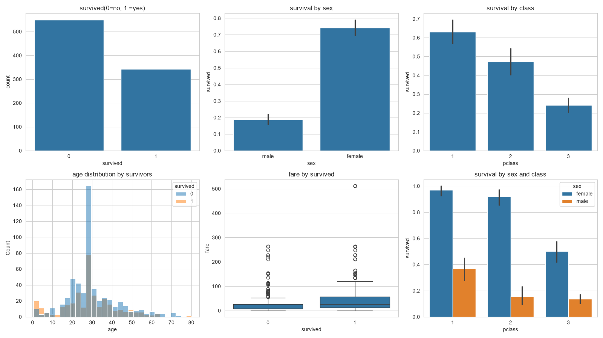
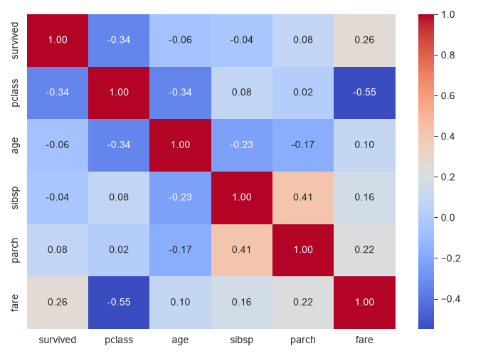
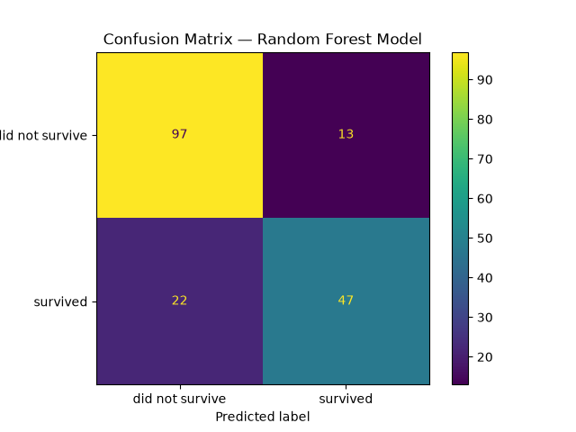
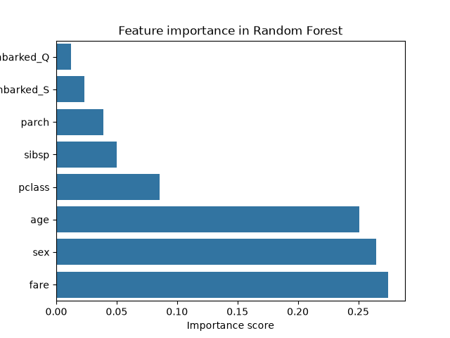

# Titanic Survival Prediction

Binary classification of Titanic passenger survival using scikit-learn. The project implements a complete machine learning pipeline, from data ingestion and cleaning through exploratory analysis, feature preparation, model training and evaluation, and compares a Logistic Regression baseline against a Random Forest classifier.

## Overview

| | |
|---|---|
| **Task** | Binary classification (`survived`: 0 = no, 1 = yes) |
| **Dataset** | Titanic passenger data (891 records), loaded via `seaborn.load_dataset("titanic")` |
| **Features** | `pclass`, `sex`, `age`, `sibsp`, `parch`, `fare`, `embarked` |
| **Split** | 80/20 stratified train/test split (712 / 179 records), `random_state=42` |
| **Models** | Logistic Regression, Random Forest (100 trees) |
| **Evaluation** | Accuracy, precision, recall, F1, confusion matrix, 5-fold stratified cross-validation |

## Repository Structure

```
titanic-survival-prediction/
├── data/
│   ├── raw/               # original dataset
│   ├── processed/         # cleaned dataset
│   ├── train/             # x_train.csv, y_train.csv
│   └── test/              # x_test.csv, y_test.csv
├── models/                # serialized models (generated by model.py)
├── plot/                  # figures used in this document
├── load_data.py           # load and inspect the raw dataset
├── cleaning.py            # missing-value handling and column selection
├── eda.py                 # exploratory data analysis and figures
├── feature.py             # encoding and train/test split
├── model.py               # model training and test-set metrics
├── model_overfit.py       # train vs. test accuracy comparison
├── evaluation.py          # confusion matrices, feature importance, cross-validation
└── requirements.txt
```

## Getting Started

**Install dependencies**

```bash
pip install -r requirements.txt
```

**Run the pipeline**

```bash
python load_data.py
python cleaning.py
python eda.py
python feature.py
python model.py
python model_overfit.py
python evaluation.py
```

Each script reads the output of the previous step, so run them in the order above.

## Methodology

### Data Cleaning

- Removed `deck` (about 77% missing values) and columns that duplicate other features (`class`, `who`, `adult_male`, `embark_town`, `alone`).
- Removed `alive`, which is identical to the target and would cause data leakage.
- Imputed missing `age` values with the median and missing `embarked` values with the mode.

### Exploratory Data Analysis

Survival rates differ sharply by sex and passenger class: women and first-class passengers survived at substantially higher rates than men and third-class passengers.





### Feature Preparation

- `sex` encoded as a binary variable (male = 0, female = 1).
- `embarked` one-hot encoded with the first category dropped.
- Stratified split on the target to preserve the class ratio in both sets.

### Modeling

- **Logistic Regression** (`max_iter=1000`) as an interpretable baseline.
- **Random Forest** (`n_estimators=100`, `random_state=42`) as a higher-capacity model.

## Results

### Train vs. Test Accuracy

| Model | Train | Test | Gap |
|---|---|---|---|
| Logistic Regression | 80.76% | 80.45% | 0.31 pts |
| Random Forest | 98.17% | 80.45% | 17.72 pts |

### Test Set Metrics

| Model | Accuracy | Precision | Recall |
|---|---|---|---|
| Logistic Regression | 0.804 | 0.793 | 0.667 |
| Random Forest | 0.804 | 0.783 | 0.681 |

### Cross-Validation

5-fold stratified cross-validation on the training set (mean ± standard deviation):

| Model | Accuracy | Precision | Recall | F1 |
|---|---|---|---|---|
| Logistic Regression | 0.794 ± 0.027 | 0.747 ± 0.049 | 0.703 ± 0.041 | 0.723 ± 0.033 |
| Random Forest | 0.808 ± 0.022 | 0.762 ± 0.045 | 0.729 ± 0.031 | 0.744 ± 0.026 |

### Confusion Matrices

| Logistic Regression | Random Forest |
|---|---|
|  |  |

### Feature Importance



## Findings

- **Equivalent generalization performance.** Both models reach about 80% accuracy on the held-out test set. In cross-validation the Random Forest leads by roughly 1.4 points, which is smaller than one standard deviation, so the difference is not significant.
- **Overfitting in the Random Forest.** Its 98% training accuracy against 80% test accuracy shows it memorizes the training data. Logistic Regression generalizes consistently (0.3-point gap).
- **Class imbalance in errors.** Both models identify non-survivors more reliably than survivors. Survivor recall is about 0.67-0.68, meaning roughly one in three survivors is missed.
- **Dominant predictors.** Sex, fare, age and passenger class account for most of the predictive signal, consistent with the exploratory analysis.
- **Model choice.** With comparable performance, Logistic Regression is the better fit for this dataset because it is simpler, less prone to overfitting, and directly interpretable.

## Future Work

- Hyperparameter tuning for the Random Forest (for example `max_depth` and `min_samples_leaf`) to reduce overfitting. Work is done in file model_overfit.py 
- Feature engineering such as family size and title extracted from passenger names.
- Evaluation of additional models, such as gradient boosting.
- Threshold tuning to improve survivor recall.